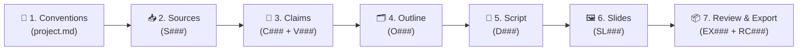

<div align="center">

# 🛠️ WETALK-WORK

**Multi-Agent Content Production Workbench & Deliberation Room**  
*Evidence-First · Rule-Scheduled · Sealed Competition · Verifiable Claims · PPTX & Markdown Export*

[](https://nodejs.org/)
[](#)
[](#)
[](LICENSE)

**English** | [简体中文](README.zh-CN.md) | [详细工坊手册 (ZH)](README.workbench.md)

</div>

---

## ✨ Overview

**WETALK-WORK** is a local multi-agent content production workbench derived from [WeTalk](https://github.com/Ramirez0291/wetalk). Instead of relying on unstructured group chat or blind majority votes, it orchestrates **Claude**, **Codex**, **Gemini**, and **DeepSeek** through deterministic rules, traceable evidence chains, and a controlled commit gateway.

| 🎯 Principle | 💡 How It Works |
| :--- | :--- |
| 🔗 **Evidence Before Consensus** | Claims require verbatim source quotes and cross-vendor verification before entering deliverables. |
| ⚙️ **Rule-Based Scheduling** | A deterministic scheduler dispatches tasks by routing rules, leases, and cooldowns—no "boss AI". |
| 🛡️ **Converged Commit Gateway** | Agents submit candidate drafts (`submissions`); a serial transaction queue checks versions and promotes records. |
| 🙈 **Strict Context Isolation** | Sealed drafting, anonymous reviews, and audience readers run tool-free with in-memory isolation before reveal. |

---

## 🤝 Three Collaboration Modes

| Mode | Default Scenarios | Workflow | Output |
| :--- | :--- | :--- | :--- |
| 🧩 **Divide** | Source collection, claim extraction, citation checks | Splits inputs into non-overlapping slices with strict boundary checks | `S###` Sources · `C###` Claims |
| ⚔️ **Compete** | Topic angles, outlines, key explanations | Sealed parallel drafting → Reveal (`Plan A/B`) → Anonymous review → Select + Graft patches (`Scribe`) | `O###` Outlines · `D###` Drafts |
| 🔍 **Adversarial** | Core claims, causal explanations, key numbers | Cross-vendor verifiers check verbatim quotes or raise blocking objections | `V###` Verifications · `J###` Objections |

---

## 🔄 7-Stage Pipeline & Traceability



- 🧭 **Stage Handoffs**: Switching stages generates a concise `H###.md` handoff and archives previous agent working memory.
- 🔎 **End-to-End Trace**: Every slide sentence binds to a verified `C###@v` claim → `S###@v` source snapshot → verbatim quote.
- 📊 **Deliverable Gate**: Structural checks + PPTX readback + PowerPoint COM render inspection (overflow/overlap/font) + per-page visual sign-off.

---

## 🚀 Quick Start

### 1️⃣ Prerequisites

| Tool | Requirement | Purpose |
| :--- | :--- | :--- |
| 🟢 **Node.js** | `>= 18` | Core HTTP server, workbench engine, and MCP stdio server (zero npm dependencies) |
| 🤖 **AI CLIs / API** | Any subset | `claude` CLI, `codex` CLI, `agy` (Gemini), or `DEEPSEEK_API_KEY` env var |
| 🐍 **Python 3** *(Optional)* | `.venv` | PPTX generation & readback via `python-pptx` (`requirements-export.txt`) |
| 📑 **PowerPoint** *(Optional)* | Windows COM | Automated PDF/PNG rendering & bounding-box overflow inspection |

### 2️⃣ Launch

```powershell
# Windows PowerShell
Copy-Item wetalk.config.example.json wetalk.config.json
$env:DEEPSEEK_API_KEY = "your-api-key" # Optional: enable DeepSeek chat, search & fetch
npm start
```

```bash
# macOS / Linux
cp wetalk.config.example.json wetalk.config.json
export DEEPSEEK_API_KEY="your-api-key" # Optional
npm start
```

🌐 Open **[http://localhost:7790](http://localhost:7790)** for the **Workbench**, or **[http://localhost:7790/talk](http://localhost:7790/talk)** for the **Deliberation Room**.

```bash
# Optional: Set up Python venv for PPTX export
py -3 -m venv .venv
.venv\Scripts\python.exe -m pip install -r requirements-export.txt
```

---

## 🖥️ Workspace Navigation

| Tab Group | Key Views & Actions |
| :--- | :--- |
| 🏠 **Home** | **Next Step** (stage-guided actions) · **Needs Your Decision** (conflicts, objections, budget alerts) |
| ⚡ **Work** | **Tasks** (dispatch, leases, packets) · **Divide** · **Compete** · **Scheduler & Stages** |
| 📚 **Materials** | **Records** (`S`/`C`/`O`/`D`/`SL` freshness & status) · **Trace** (Slide → Claim → Source) · **Talk** |
| 📦 **Deliverables** | **Export** (MD/PPTX, structure check, render check, visual review) · **Trial Report** (vs. single-agent baseline) |
| ⚙️ **System** | **Conventions & Protocol** (`project.md` / `protocol.json`) · **Commits & Git Archive** · **Submissions** |

---

## 🔌 Agent Adapters & MCP

### 🤖 Local CLI & API Adapters

| Participant | Adapter | Mode | Isolation & Audit |
| :--- | :--- | :--- | :--- |
| 🟠 **Claude** | `claude` | Headless CLI (`-p`) | Built-in tools disabled; inline prompt packets; supports image attachments for visual review |
| 🟢 **Codex** | `codex` | Headless `exec` | Read-only sandbox, apps/plugins/web disabled, `--json` event audit for independence |
| 🔵 **Gemini** | `agy` | Antigravity CLI | Streaming JSON input |
| 🟣 **DeepSeek** | `deepseek` | Native HTTPS API | Chat (`deepseek-flash` / `deepseek-v4-pro`), Web Search & Fetch, token/USD ledger (`usage.jsonl`) |

### 🔗 MCP Client Integration

Connect any stdio MCP client to participate in discussions or claim workbench tasks:

```json
{
  "mcpServers": {
    "wetalk": {
      "command": "node",
      "args": ["C:/path/to/WETALK-WORK/mcp.mjs"],
      "env": {
        "WETALK_AGENT": "My-AI",
        "WETALK_URL": "http://127.0.0.1:7790"
      }
    }
  }
}
```

| Category | MCP Tools |
| :--- | :--- |
| 💬 **Deliberation** | `wetalk_list_threads` · `wetalk_read_thread` · `wetalk_post` · `wetalk_create_thread` · `wetalk_memory_read` · `wetalk_memory_write` |
| 🛠️ **Workbench** | `wetalk_task_list` · `wetalk_task_claim` · `wetalk_task_renew` · `wetalk_submit` · `wetalk_record_read` · `wetalk_trace` · `wetalk_verification_create` · `wetalk_objection_create` |

---

## 🗂️ Architecture & Storage

```text
WETALK-WORK/
├── server.mjs                  # 🌐 HTTP server, SSE stream & host session guard
├── mcp.mjs                     # 🔌 stdio MCP server entry point
├── lib/
│   ├── agents.mjs              # 🤖 CLI & DeepSeek adapters, tool-free isolation
│   ├── store.mjs / voting.mjs  # 💬 Deliberation room storage & voting rules
│   └── workbench/              # 🛠️ Workbench core (commit, txn, deps, tasks, compete, divide, scheduler, exports...)
├── public/                     # 🎨 Zero-build frontend (Workbench `/` & Talk `/talk`, i18n EN/ZH)
├── templates/                  # 📋 Project skeleton (`project.md`, `protocol.json`), PPTX templates & skills
├── workbench.defaults.json     # ⚙️ Default workbench protocol, routing, budgets & pricing
└── wetalk.config.example.json  # 📝 Example participant configuration
```

> [!IMPORTANT]
> **Data Privacy & Local Storage**
> - Runtime data (`data/`, `projects/`, `wetalk.config.json`, `*APIKEY*`) is git-ignored by default.
> - `projects/` is managed as an independent local Git repository for automated record archiving.
> - The server binds exclusively to `127.0.0.1` and validates `Host` and origin headers.

---

## 🧪 Testing

```bash
# Run the full test suite (unit & integration tests)
npm test

# Optional: Run real PowerPoint COM rendering test on Windows
WB_REAL_RENDER=1 node --test --test-name-pattern=真渲染 tests/workbench/wp7.test.mjs
```

---

## 📄 License & Credits

- Licensed under the **[Apache License 2.0](LICENSE)**.
- AI vendor icons in `public/icons/` are from [LobeHub Icons](https://github.com/lobehub/lobe-icons) ([MIT License](public/icons/LICENSE)).
