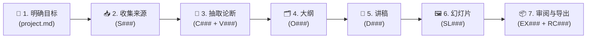

<div align="center">

# 🛠️ WETALK-WORK（WETALK 工坊）

**多 Agent 内容生产工坊与多方研讨室**  
*证据链先于共识 · 规则程序调度 · 密封竞争与移植补丁 · 交叉对抗核验 · PPTX 与 Markdown 导出*

[](https://nodejs.org/)
[](#)
[](#)
[](LICENSE)

[English](README.md) | **简体中文** | [📖 详细工坊手册](README.workbench.md)

</div>

---

## ✨ 核心设计

**WETALK-WORK** 是从 [WeTalk](https://github.com/Ramirez0291/wetalk) 派生的本地多 Agent 内容生产工坊。它不靠自由群聊或少数服从多数来掩盖事实错误，而是用**可追溯证据链、规则调度程序、单写入者提交入口**组织 **Claude**、**Codex**、**Gemini** 与 **DeepSeek** 协作产出可核验的讲稿与演示文稿。

| 🎯 核心原则 | 💡 实现机制 |
| :--- | :--- |
| 🔗 **证据链先于共识** | 论断必须绑定来源快照中的逐字引文，并通过跨厂商独立核验，才能进入成品。 |
| ⚙️ **无领导，但有调度** | 由确定性规则程序按分工表、租约和冷却状态派发任务，不设“老板模型”。 |
| 🛡️ **判断分散，提交收敛** | Agent 各自交候选稿（`submissions`），经仓库级串行队列校验版本与依赖后晋升（`promote`）。 |
| 🙈 **严格的可见性隔离** | 密封起草、匿名评审、观众型读者均采用无工具内联调用，揭晓前结果仅驻留内存。 |

---

## 🤝 三种协作方式

| 工作方式 | 默认适用场景 | 协作流程 | 正式产出 |
| :--- | :--- | :--- | :--- |
| 🧩 **分工 (Divide)** | 搜集资料、抽取论断、检查引用 | 输入拆为互不重叠的子集，晋升时严格拦截越界修改 | `S###` 来源卡 · `C###` 论断 |
| ⚔️ **竞争 (Compete)** | 选题角度、大纲、核心解释 | 密封独立起草 → 随机标签揭晓 → 匿名评审 → 选定底稿 + 移植补丁（书记规则合成） | `O###` 大纲 · `D###` 讲稿 |
| 🔍 **对抗核验 (Verify)** | 核心结论、因果解释、重要数字 | 跨厂商核验者核对逐字引文，或提出可定位的阻塞异议与自动补证 | `V###` 核验 · `J###` 异议 |

---

## 🔄 七步流程与全链路追溯



- 🧭 **阶段交接与遗忘**：切换阶段时自动生成一页以内的交接单 `H###.md`，归档并清空旧阶段工作记忆。
- 🔎 **从页面到原文追溯**：幻灯片每句绑定 `C###@v` 论断 → 追溯至 `S###@v` 来源快照与原文引文，上游改动自动标记下游“待复核”。
- 📊 **成品可交付门禁**：结构检查 + PPTX 读回核对 + 本机 PowerPoint 渲染检查（溢出/重叠/缺字/变形）+ 逐页视觉初查与主持人终审。

---

## 🚀 快速开始

### 1️⃣ 环境要求

| 组件 | 要求 | 用途说明 |
| :--- | :--- | :--- |
| 🟢 **Node.js** | `>= 18` | 核心服务、工坊引擎与 MCP 接入口（零第三方 npm 运行依赖） |
| 🤖 **AI CLI / API** | 任选其一或组合 | `claude`、`codex`、`agy` (Gemini) 命令行，或 `DEEPSEEK_API_KEY` 环境变量 |
| 🐍 **Python 3** *(可选)* | `.venv` | 基于 `python-pptx` 生成 PPTX 与读回核对（见 `requirements-export.txt`） |
| 📑 **PowerPoint** *(可选)* | Windows COM | 后台静默转 PDF/PNG 并检测文本框溢出、重叠与字体缺失 |

### 2️⃣ 启动服务

```powershell
# Windows PowerShell
Copy-Item wetalk.config.example.json wetalk.config.json
$env:DEEPSEEK_API_KEY = "你的密钥" # 可选：启用 DeepSeek 对话、Search 与 Fetch
npm start
```

```bash
# macOS / Linux
cp wetalk.config.example.json wetalk.config.json
export DEEPSEEK_API_KEY="你的密钥" # 可选
npm start
```

🌐 浏览器打开 **[http://localhost:7790](http://localhost:7790)** 进入**工坊**（或打开 **[http://localhost:7790/talk](http://localhost:7790/talk)** 进入**研讨室**）。

```powershell
# 可选：配置 PPTX 导出所需的 Python 虚拟环境
py -3 -m venv .venv
.venv\Scripts\python.exe -m pip install -r requirements-export.txt
```

---

## 🖥️ 工坊界面速览

| 分组 | 核心页面与功能 |
| :--- | :--- |
| 🏠 **首页** | **下一步**（按当前阶段一键推进） · **待你决定**（处理异议裁决、核验分歧、外部改动与预算超限） |
| ⚡ **工作** | **任务**（新建/派发/查看任务包） · **分工** · **竞争** · **调度与阶段**（自动调度、跑一轮、阶段切换） |
| 📚 **资料** | **记录**（查看新鲜度、核验与可进入成品状态） · **追溯**（页面 → 论断 → 来源原文） · **研讨** |
| 📦 **成品** | **导出**（MD/PPTX 导出、结构与渲染检查、逐页视觉终审） · **报告**（对比单 Agent 基线指标） |
| ⚙️ **约定与系统** | **项目约定与参数**（可视化编辑 `project.md` 与 `protocol.json`） · **提交与留档** · **候选稿** |

---

## 🔌 Agent 接入与 MCP 工具

### 🤖 本地 CLI 与 API 适配器

| 参与者 | 适配器 | 调用方式 | 隔离与审计机制 |
| :--- | :--- | :--- | :--- |
| 🟠 **Claude** | `claude` | CLI 无头调用 (`-p`) | 关闭内置工具，输入内联进提示词；支持附带截图执行逐页视觉初查 |
| 🟢 **Codex** | `codex` | CLI `exec` 无头调用 | 只读沙箱，禁用插件/网页/多 Agent，按 `--json` 事件流审计独立性 |
| 🔵 **Gemini** | `agy` | Antigravity CLI | 流式 JSON 标准输入传递 |
| 🟣 **DeepSeek** | `deepseek` | 原生 HTTPS API | 支持对话、网页 Search 与正文 Fetch，自动记录 token 与费用账本 (`usage.jsonl`) |

### 🔗 MCP 客户端接入

在支持 stdio MCP 的客户端中添加服务器，即可参与研讨或认领工坊任务：

```json
{
  "mcpServers": {
    "wetalk": {
      "command": "node",
      "args": ["C:/path/to/WETALK-WORK/mcp.mjs"],
      "env": {
        "WETALK_AGENT": "My-AI",
        "WETALK_URL": "http://127.0.0.1:7790"
      }
    }
  }
}
```

| 类别 | 可用 MCP 工具 |
| :--- | :--- |
| 💬 **多方研讨室** | `wetalk_list_threads` · `wetalk_read_thread` · `wetalk_post` · `wetalk_create_thread` · `wetalk_memory_read` · `wetalk_memory_write` |
| 🛠️ **生产工坊** | `wetalk_task_list` · `wetalk_task_claim` · `wetalk_task_renew` · `wetalk_submit` · `wetalk_record_read` · `wetalk_trace` · `wetalk_verification_create` · `wetalk_objection_create` |

---

## 🗂️ 目录结构与数据安全

```text
WETALK-WORK/
├── server.mjs                  # 🌐 HTTP 服务、SSE 实时流与主持人会话校验
├── mcp.mjs                     # 🔌 stdio MCP 接入口
├── lib/
│   ├── agents.mjs              # 🤖 CLI 与 DeepSeek 适配器、无工具隔离与审计
│   ├── store.mjs / voting.mjs  # 💬 研讨室存储与表决规则
│   └── workbench/              # 🛠️ 工坊核心（提交、写前日志、依赖派生、分工、竞争、调度、导出等）
├── public/                     # 🎨 原生前端（工坊 `/` 与研讨室 `/talk`，支持中英切换）
├── templates/                  # 📋 项目模板（`project.md`、`protocol.json`）、PPTX 模板与版式 Skill
├── workbench.defaults.json     # ⚙️ 工坊默认参数、分工路由、预算上限与计费表
└── wetalk.config.example.json  # 📝 参与者配置示例
```

> [!IMPORTANT]
> **隐私与本地存储说明**
> - `.gitignore` 已默认排除运行数据（`data/`、`projects/`）、本地配置（`wetalk.config.json`）、密钥文件（`*APIKEY*`）与内部开发记录。
> - `projects/` 作为独立的本地 Git 仓库由服务自动初始化并按提交清单留档，不随代码仓库上传。
> - 服务仅监听 `127.0.0.1` 并严格校验 `Host` 与写请求来源。

---

## 🧪 运行测试

```bash
# 运行全部单元与集成测试
npm test

# 可选：在安装有 PowerPoint 的 Windows 上执行真实 COM 渲染检查测试
WB_REAL_RENDER=1 node --test --test-name-pattern=真渲染 tests/workbench/wp7.test.mjs
```

---

## 📄 许可证与致谢

- 项目代码采用 **[Apache License 2.0](LICENSE)** 开源许可证。
- `public/icons/` 中的 Claude、Codex、Gemini 图标来自 [LobeHub Icons](https://github.com/lobehub/lobe-icons)（保留独立 [MIT 许可声明](public/icons/LICENSE)）。
