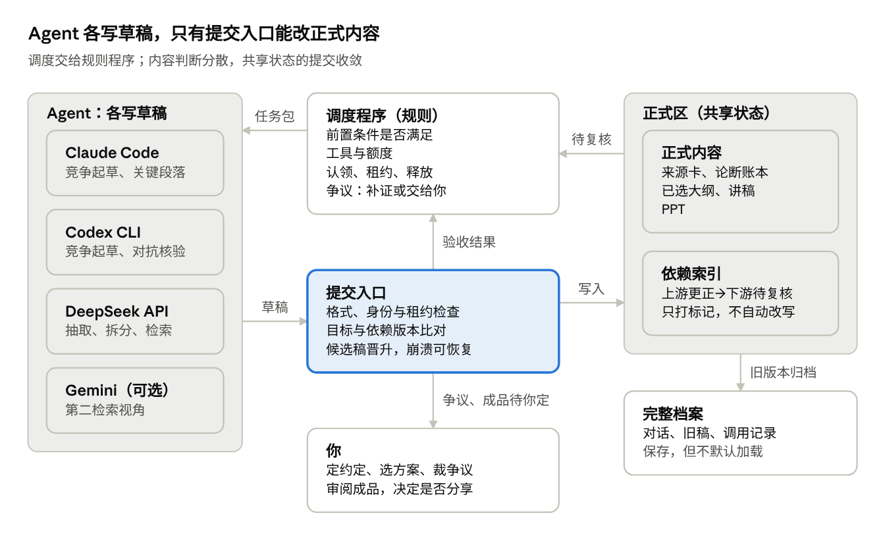

# claudework 多 Agent 工坊设计 V2

Oct 18, 2026 · @LI(RAMI)LINGYUE

V2 以 WETALK 为基础，派生出一个按任务性质切换三种工作方式的工坊（独立仓库，WETALK 本身保持轻便）：证据链先于共识，调度交给规则程序，内容判断分散、正式内容的提交收敛。文中规则是试运行的默认值，可以按项目调整（见“可调整的部分”）。相比 V1，撤回了“提不出修复方案就取消阻塞资格”这条规则。实现细节以 WETALK 工坊开发文档 里的四份契约为准。

## 设计原则

1.  **按任务性质切换工作方式。** 不是所有任务都要经历“讨论—投票—再讨论”。

2.  **证据链先于共识。** 两个不同厂商的模型同意，不等于事实已经核实。

3.  **螺旋上升要能具体指出。** 每一轮都要说清：新增了哪条证据、修正了哪个错误，或让哪个概念更容易理解。一致率和讨论轮数不作为成功指标。

4.  **无领导，但有调度。** 调度权交给一个执行规则的普通程序，不交给某个模型，也不让所有 Agent 协商下一步。

5.  **内容判断权分散，共享状态的提交权收敛。** 各 Agent 可以同时写自己的草稿；正式的大纲、事实账本、最终 PPT 只能经受控的提交入口更新。

6.  **同步项目状态，而不是同步每个人的全部思考。** 资料和审计记录长期保存；进入模型上下文的内容严格筛选。

7.  **规则留出修改空间。** 本文规则是试运行配置，不是定论；版本校验、身份绑定、引用完整性这类一致性要求除外，它们是系统不变量；修改方式见最后一节。

## 整体结构

Agent 从调度程序领取固定版本的任务包，草稿只有通过提交入口才能写进正式区；正式区里的上游更正，会经依赖索引变成新的待复核任务。

## 三种工作方式

按任务性质选择，同一个项目里三种方式会交替出现。表中的对应关系是默认值，单个任务可以改。

| 工作方式 | 默认用在                     | 怎么协作                                        | 产出                 |
|----------|------------------------------|-------------------------------------------------|----------------------|
| 分工     | 搜集资料、抽取论断、检查引用 | 各做不同任务，提交结构化结果                    | 来源卡、论断条目     |
| 竞争     | 选题角度、大纲、核心解释     | 两个 Agent 独立提出方案，完成前互不可见，再比较 | 选定的方案＋移植补丁 |
| 对抗核验 | 核心结论、因果解释、重要数字 | 一方提出论证，另一方寻找反例和证据缺口          | 核验记录，修正或删除 |

- **分工的例子：** 处理十篇资料时，不让四个模型各读十篇再开会。先分配资料，汇总来源卡，只对关键结论交叉检查。

- **竞争的例子：** 决定“这份 PPT 应该怎样讲”时，保留两个独立大纲。它们提供的是不同的内容结构，而不只是更多文字。

- **竞争的结果是选择，不是合并。** 选定一份作为底稿；从落选方案里保留的内容，写成一条条点名的移植补丁，比如“把 B 第 3 节的开场问题移到 A 的第 1 页”，逐条接受或拒绝。这样综合就是一串可追查的小决定，不会变成一次看不见的重写。

## 调度与提交

调度程序只执行规则，不做内容判断。它负责判断：

- 哪些任务的前置条件已经满足；

- 哪些 Agent 具备所需工具、还有额度（额度先按调用失败来判断：被限流后暂停该 Agent 一段时间）；

- 谁已认领任务，租约何时到期，到期自动释放；

- 结果有没有通过格式和验收检查；

- 哪些争议需要补证，哪些需要你选择。

Agent 可以提出新任务、认领任务、挑战结果，但任务状态由程序统一维护。

**两种权限分开。**

- 内容判断权分散：每个 Agent 可以同时写自己的草稿。

- 提交权收敛：正式的大纲、事实账本、最终 PPT 只能经提交入口更新。提交入口先把结果收为候选稿，再在串行的临界区里检查目标版本和依赖版本，通过后晋升为正式版本；中途崩溃可以按提交日志恢复。

**不能只靠工具权限保证隔离。**

- “只能写自己的目录”和“看不到别人的草稿”是两个要求。工具权限规则不等于操作系统沙箱，没有实测过的隔离不能宣称完成。

- 密封起草、匿名评审和观众型读者都用无工具调用：固定任务包从标准输入传入，结果由服务端收集。密封期间的稿子只留在服务进程内存里，揭晓后才写入磁盘。

- Codex 自带执行命令的能力，密封任务里审计它执行过的命令，读过文件的稿子标为“独立性未证明”。

**综合本身就是内容决策。** 负责综合的书记不能删除异议，也不能重写胜出方案。它只按规则应用已经通过的补丁，未采纳的意见进入少数意见记录。否则它就成了隐藏的老板。

## 记忆与任务包

记忆分四层，只有前两层会进入新任务。这同时解决“需要记忆”和“需要遗忘”的矛盾。

| 层次           | 保存内容                               | 是否默认进入新任务 |
|----------------|----------------------------------------|--------------------|
| 项目约定       | 受众、目的、篇幅、风格、验收标准       | 是                 |
| 共享知识与状态 | 来源、论断、已选方案、待办、未解决分歧 | 按任务加载         |
| Agent 工作笔记 | 临时假设、探索方向、个人草稿           | 仅本人当前阶段使用 |
| 完整档案       | 对话、旧稿、历史决策、调用记录         | 保存，但不默认加载 |

**任务包。** 一次任务开始时，Agent 获得一个固定版本的任务包：任务目标＋项目约定＋相关证据＋当前作品＋尚未解决的问题。任务包保存实际输入的内容（按内容 hash 存档），以及实际发送的提示词和有效配置；hash 只用来检查内容有没有变，不能代替内容本身。

**状态由记录推算，不直接保存。** 程序从引用字段推出每件产物依赖哪些编号的哪个版本，并维护一张反向索引。上游一变，下游自动算作待复核或待更新，绝不自动覆盖。因为是推算出来的，即使中途崩溃，重启后也不会出现“来源已更新、下游没标记”。例：来源 S12 被更正 → 论断 C07 待复核 → 引用 C07 的第 6 页 PPT 待更新。论断的核验状态、版本新鲜度、未解决的阻塞分开计算，三者都满足才能进入成品。

**阶段切换时遗忘。** 新阶段开启新会话，保留证据和当前作品，不加载此前的争论。“上次尝试失败”可以存档，但不自动成为新 Agent 必须接受的结论。

**新读者。** 默认使用观众型读者：只给讲稿或 PPT，不给证据，让它复述核心观点、标出看不懂的地方。它测的是“概念是否更容易理解”，也是对付思维停滞的主要办法。需要时可以加审稿型读者（作品＋证据，测论证是否成立），但它不是默认环节。

## 证据与分歧

可靠的内容生产，靠的是可追溯的证据链，而不是多数同意。

**论断分四类。**

- **事实：** 可以对照来源核实的陈述。

- **文献记载：** 某部文献记载了什么。必须带“最早出处”字段，并区分原典、学者解释、流行演绎。例：“盘古开天辟地”一般认为最早见于三国时期吴人徐整的《三五历纪》。把晚出的记载说成上古传说，是神话内容最常见的错误。

- **解释：** 学者或作者对事实的解读。

- **推测：** 没有直接证据支持的推断，必须标明。

**来源要独立。** 三个网页转载同一篇文章，只算一条证据链。独立性按“最早可追溯出处”判断。

**证据只来自原文。** 核验时只认 Fetch 抓到的正文或原始文献，不认搜索结果里的 summary 或 snippet。否则“直接查原文”会悄悄退化成“查摘要的摘要”。

**分歧按类型处理。**

| 分歧类型                             | 处理方式                       | 是否阻塞               |
|--------------------------------------|--------------------------------|------------------------|
| 来源不存在、数字错误、引文不支持结论 | 补证、修正或删除相关内容       | 是，先暂停使用这条结论 |
| 学术解释存在争议                     | 并列展示解释，标注适用范围     | 否                     |
| 叙事顺序、标题、比喻选择             | 按受众目标评分，由你或投票选择 | 否                     |
| 可选扩展、理论上还能更完整           | 放入待办                       | 否                     |

**核验分两步。** 程序只检查指针是否有效：引文是否出现在来源正文里、Fetch 记录是否存在、来源字段是否为空。这只能证明“指得到”，证明不了“支持结论”——来源写“没有证据表明 A 导致 B”，论断写“A 导致 B”，引文检查一样会通过。是否支持由核验者判断：核验者必须与作者分属不同厂商，判为支持时要附可定位的引文，结果绑定论断和来源的版本，可以被再次挑战。

- 提出质疑的人有责任指出问题在哪里，没有责任给出修改方法。

- 发现了问题但暂时定位不到原文（例如数字前后矛盾），进入“待补证”：照样阻塞，并生成补证任务；补证超过次数上限交给你，不会自动变成无关紧要的意见。

- Fetch 失败只说明来源暂不可获取：保留已有快照，快照仍可作证据。

- 对归类本身有争议的，交给你。

## PPT 生产流程

七步按顺序进行，第 4 步用竞争方式，其余以分工和对抗核验为主。

1.  明确观众看完后应当理解什么。

2.  收集来源，保留原文位置和版本。

3.  抽取论断，区分事实、文献记载、解释、推测。

4.  独立提出两个大纲，比较并选定一个，可以附移植补丁。

5.  写讲稿和逐页内容，关联论断编号。

6.  生成幻灯片，检查图表、文字溢出、可读性和备注。

7.  你审阅成品并决定分享。

最终值得积累的是“资料包＋知识稿＋讲稿＋PPT”。下一次换受众或换呈现形式，就能复用前面的知识成果。

## 模型分工（试运行配置）

DeepSeek 作为默认 API 后端，Gemini 保留为可选能力。这是试运行配置，不是对模型能力的永久排名。

| 工作                           | 初始安排                         |
|--------------------------------|----------------------------------|
| 批量抽取、去重、标签、论断拆分 | DeepSeek API                     |
| 已给定材料的摘要、结构检查     | DeepSeek API，抽样复核           |
| 大纲竞争、关键段落写作         | Claude 与 ChatGPT/Codex 独立参与 |
| 重要论断核验                   | 与起草者不同的模型，直接检查原文 |
| 常规网页检索                   | 先试 DeepSeek Search / Fetch     |
| 搜索覆盖不足、需要第二检索视角 | Gemini Grounding                 |
| 最终取舍、受众适配             | 你                               |

- **DeepSeek Search / Fetch** 是独立接口，需要接入工作流，普通模型调用不会自动搜索。每 1000 次成功请求 \$0.75，失败、空结果、超时不计费，每个账户每秒 5 次。搜索结果的 authority、date 字段只作建来源卡时的初步线索。

- **Gemini Grounding** 把搜索、回答和引用信息整合在一次调用里。价值是集成方便和另一套搜索覆盖；带引用的回答仍要检查原始页面。

- **错峰运行：** 据第三方资料，DeepSeek 工作日高峰时段是东京时间 10–13 点和 15–19 点，高峰价是低谷的两倍。大批量任务放到晚上跑，价格以官方价目为准。

## WETALK 与开源组件

第一版保持克制：重点是补上“任务和作品状态”，而不是继续增加讨论功能。

**保留。** 通用命令行适配器、密封投票、多种通过规则、“保留异议”、记忆版本与冲突检测、调用记录（calls.jsonl）。这些是 WETALK 已有的结晶。

**要改的三处现状。**

- 讨论提示词明确禁止读写文件 → 起草者开放项目文件夹的只读权限，写入限定在自己的草稿目录。

- 记忆主要按参与者保存 → 改为上面的四层结构。

- 长对话截断时保留开题帖和最近发言 → 改为保留项目约定、决议摘要或交接单，以及最近发言。

**开源组件。**

- **工坊仓库：** 从 WETALK 派生，继承界面、讨论与调用，新增任务和作品状态；WETALK 本身保持轻便。

- **Markdown 和现有存储：** 先保存来源卡、知识稿、任务与决策，用写前日志保证提交一致；需要更复杂的事务时，再考虑数据库。

- **[Basic Memory](https://github.com/basicmachines-co/basic-memory)：** 跨项目查找资料开始困难后再加入，作为检索层。它支持 Markdown、MCP 和语义搜索，但项目事实是否成立仍由证据流程决定。

- **[STORM / Co-STORM](https://github.com/stanford-oval/storm)：** 借鉴“多视角提问—检索—大纲—写作”的方法。它的产出仍需编辑，不能直接视为可发布成品。

- **暂不引入：** 多个记忆框架和编排平台。否则还没产出第一份内容，就要维护好几套状态同步。

## 试运行路线图

用一份分享型 PPT 贯穿整个试运行。基线版和多 Agent 版使用同一个主题、同一份内容标准，否则比较的是题目难度，而不是协作方式。

| 顺序 | 建设任务                                   | 完成标准                                                                       |
|------|--------------------------------------------|--------------------------------------------------------------------------------|
| 1    | 定义内容标准，并跑一次现有单 Agent 流程    | 得到可比较的基线，记录你的修改时间                                             |
| 2    | 增加来源卡、论断、作品版本，以及提交与恢复 | 能从一页 PPT 追溯到具体原文；中途崩溃后状态一致                                |
| 3    | 接入 DeepSeek API 适配器                   | 能调用、记录用量、超时退出，失败可重试                                         |
| 4    | 增加任务契约与任务包                       | 同一任务不会重复提交；旧执行者迟到不覆盖新结果；换模型或新会话后能凭任务包继续 |
| 5    | 增加三种工作方式与两步核验                 | 两份大纲完成前互不可见；评审指向具体问题；核验绑定版本                         |
| 6    | 增加自动调度与阶段重置                     | 由规则派发任务，有调用与费用上限；阶段重置不影响其他项目                       |
| 7    | 跑通 PPT 输出、渲染检查及成品验收          | 交付可分享内容，记录剩余人工工作                                               |
| 8    | 再决定检索库、自动分工和编码支持           | 每项新增功能都有真实瓶颈作为依据                                               |

**试运行重点看四项：**

- 核心论断能否追溯到有效证据；

- 人工抽查发现多少实质错误；

- 你需要花多少时间才能放心分享；

- 相比单 Agent，额外成本换来了什么改善。

**每轮改动要记账。** 改动记录挂在具体编号上，并标明类型：新增证据、修正错误、提高可理解性。一轮下来三类都是零，就是停滞信号：停下，或换一个新读者来看。

只在多 Agent 确实带来收益的阶段保留它。批量格式转换可能一个模型就够，大纲竞争和关键结论核验则可能值得多人参与。

## 可调整的部分

本文的规则是起点，不是定论。下面这些都可以按项目或按任务调整。版本校验、身份绑定、引用完整性、密封与匿名规则，以及“各类上限必须存在”，是系统不变量，不在此列。

| 可调整项                     | 默认值                       | 何时考虑调整                           |
|------------------------------|------------------------------|----------------------------------------|
| 任务与工作方式的对应         | 见“三种工作方式”表           | 某类任务用多 Agent 没有带来改善        |
| 新读者类型                   | 观众型                       | 内容涉及有争议的事实或数字时，加审稿型 |
| 竞争方案数量                 | 2 份                         | 选题差异很大，或两份大纲高度雷同       |
| 讨论与表决轮次上限           | 沿用 WETALK 现有设置         | 频繁出现僵局或过早结束                 |
| 任务租约时长                 | 30 分钟（建议初值）          | 常出现超时释放，或任务被长期占用       |
| 模型分工                     | 见“模型分工”表               | 额度、价格或质量发生变化               |
| 补证次数与核心结论的核验份数 | 补证 2 次；核心结论 2 份核验 | 补证常常超时，或核验结论经常不一致     |
| 记忆加载策略                 | 前两层默认加载               | 新会话频繁缺少必要上下文               |

**修改方式：**

- 规则写在配置文件里，不写死在代码中；

- 每次修改记一条决策记录：改了什么、为什么、依据哪次试运行的数据；

- 每期内容做完后复盘一次，决定保留、调整还是撤回。

## 参考来源

- [DeepSeek API Docs — Search & Fetch](https://api-docs.deepseek.com/guides/search)

- [Gemini API — Grounding with Google Search](https://ai.google.dev/gemini-api/docs/google-search)

- [Claude Code Docs — Configure permissions](https://code.claude.com/docs/en/permissions.md)

- [basicmachines-co/basic-memory](https://github.com/basicmachines-co/basic-memory)

- [stanford-oval/storm](https://github.com/stanford-oval/storm)

- [DeepSeek API: Models, Pricing（Morph，第三方）](https://www.morphllm.com/deepseek-api)

- [LLM Council by Andrej Karpathy（Analytics Vidhya）](https://www.analyticsvidhya.com/blog/2025/12/llm-council-by-andrej-karpathy/)
